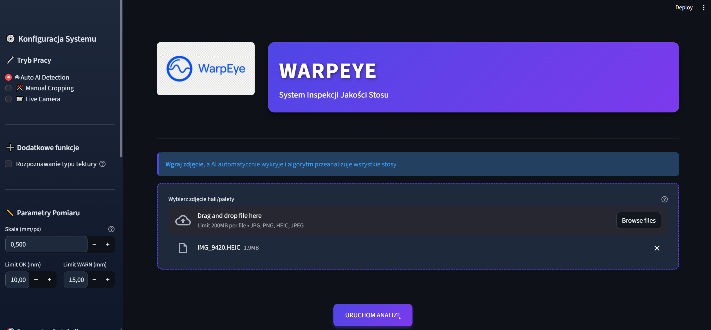
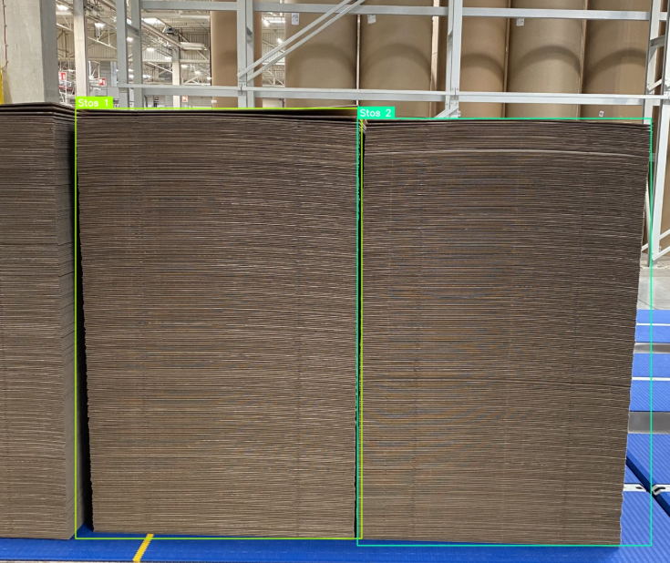
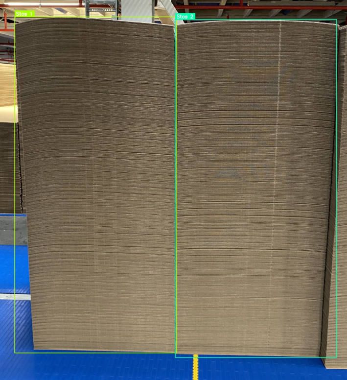
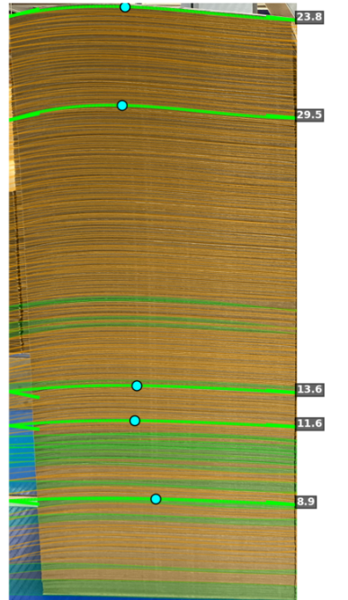
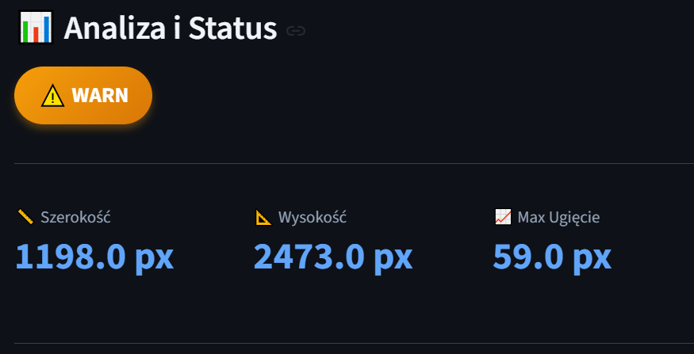
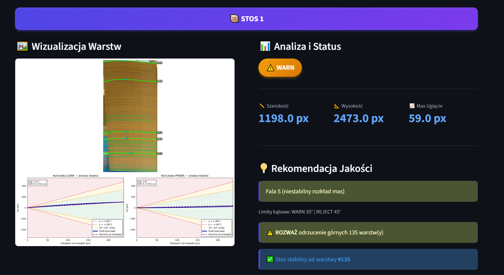
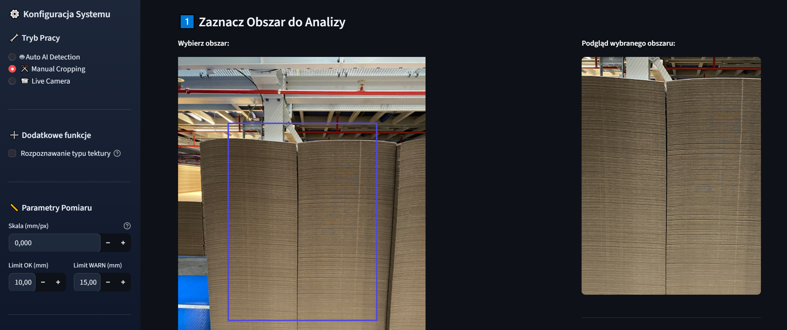
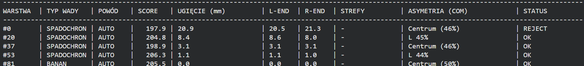

# 📦 Modelowanie łukowatości tektury falistej (Streamlit Dashboard)

> **Status projektu:** Zamknięte repozytorium / Case Study (Kod źródłowy zastrzeżony). Wizualizacja interaktywnego panelu analitycznego do kontroli geometrii tektury falistej.

## 🎯 Cel projektu
Opracowanie aplikacji analitycznej w ekosystemie Pythona służącej do bezkontaktowej metrologii łukowatości arkuszy tektury oraz innych metryk na podstawie zdjęć 2D.

## 🛠️ Stack Technologiczny
* **Frontend / Dashboard:** Streamlit (interaktywne widgety, dynamiczne wykresy)
* **Przetwarzanie danych i sygnałów:** `NumPy`,`OpenCV,` `SciPy` (filtracja Savitzky'ego-Golaya, transformacje oparte na cięciach)
* **Wizualizacja:** Matplotlib / Plotly

---

## 📸 Podgląd aplikacji i dopasowania linii (Streamlit UI)

<table>
  <tr>
    <td align="center" width="50%"><b>1. Panel główny</b>  </td>
    <td align="center" width="50%"><b>2. Widok aplikacji</b>  </td>
  </tr>
  <tr>
    <td align="center" width="50%"><b>3. Segmentacja stosów</b>  </td>
    <td align="center" width="50%"><b>4. Dopasowanie linii</b>  </td>
  </tr>
  <tr>
    <td align="center" width="50%"><b>5. Podgląd wyników</b>  </td>
    <td align="center" width="50%"><b>6. Statystyki</b>  </td>
  </tr>
  <tr>
    <td align="center" width="50%"><b>7. Manual cropping</b>  </td>
    <td align="center" width="50%"><b>8. Statystyki zaawansowane</b>  </td>
  </tr>
</table>

---

## ⚙️ Kluczowe Funkcjonalności Dashboardu
1. **Automatyczne dopasowanie linii referencyjnej do chmury punktów** .
2. **Opracowanie metryk jakościowych do precyzyjnej oceny i klasyfikacji struktur**. 
3. **Aplikacja posiada 3 tryby: Auto AI, Manual cropping, Live camera**.
4. **Panel konfiguracyjny dla użytkownika po lewej stronie jako pasek boczny**.
5. **Graficzna prezentacja wyników**.